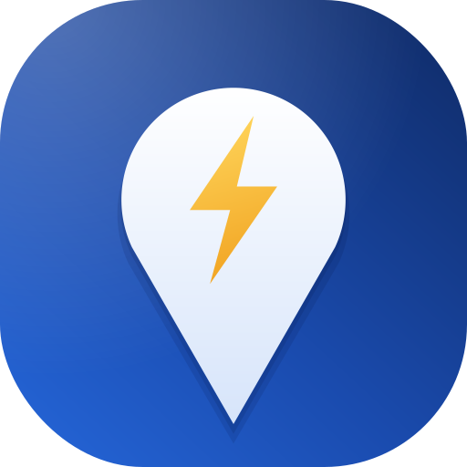

  

<h1 align="center">ELdoroado</h1>

  <b>Electric · do · road</b> – das eigene Navi fürs E-Auto 
  Routen- und Ladeplanung, Navigation, OBD2-Live-Daten und ein lokaler KI-Assistent – privat, ohne Werbung, ohne Konto.

  <b>Deutsch</b> · <a href="#english">English</a>

---

ELdoroado ist eine private Android-App für Elektroautos, entwickelt mit dem **Citroën ë-C4 (2022)** und nutzbar für die E-Autos von **Stellantis** auf e-CMP-Basis (Citroën, Peugeot, Opel, DS, Jeep, Fiat, Lancia, Alfa Romeo), für **Leapmotor** sowie mit eigenen Fahrzeugwerten. Der Name verbindet *electric*, *do* und *road* mit dem sagenhaften Eldorado.

## Inhalt

- [Funktionen](#funktionen)
- [Voraussetzungen](#voraussetzungen)
- [APK bauen und installieren](#apk-bauen-und-installieren)
- [Erste Einrichtung](#erste-einrichtung)
- [Datenquellen](#datenquellen)
- [Technik](#technik)
- [Grenzen](#grenzen)
- [Datenschutz und Sicherheit](#datenschutz-und-sicherheit)
- [Lizenzen und Danksagungen](#lizenzen-und-danksagungen)

---

## Funktionen

### 🗺️ Karte und Navigation
- Kartenstile **Bright**, **Positron** und **TomTom** am Tag, **Fiord** und **Schwarz** in der Nacht, automatischer Wechsel
- Bis zu drei Routenvorschläge mit Ankunftszeit, Ladestopps und Akku am Ziel
- Abbiegehinweise mit **Spurassistent**, Straßenschildern (A/B/L) und Sprachansagen
- **Verkehr** direkt auf der Routenlinie, Stauwarnungen mit Verzögerung, automatische Neuberechnung
- **Tempolimit** mit Warnung bei Überschreitung
- **Tunnel-Modus:** bis zu 45 Sekunden ohne GPS weiterrechnen
- Fahransicht mit stufenlosem Zoom und weicher Kamera
- **Nächster Halt** in der Fußleiste: Ankunftszeit und Akku am nächsten Lade- oder Zwischenstopp, darunter das Ziel
- Offline-Karten für Gebiete ohne Netz

### 🔋 Laden und Akku
- Ladeplanung mit **TomTom Long Distance EV Routing**, mit Ladekurve, Verbrauchsmodell, Wetter und Höhenmetern
- **Live-Belegung** der Ladesäulen nach Stecker und Leistung
- Eigene Ladestopps, „Anderen wählen“ und Ladesuche entlang der Route
- **Lade-Assistent** am Schnelllader: „Lade von 18 % auf 62 %, ca. 24 min – fertig gegen 13:58“, danach **Weiterfahren** mit Abgleich per OBD und Neuberechnung bei Abweichung
- Reichweiten-Blase auf der Karte
- Parken und Laden am Ziel

### ✨ Planung mit Wünschen und KI-Assistent
- Wünsche für die Route: **nur bestimmte Anbieter** (z. B. nur Tesla) oder bestimmte meiden, **Pause** zu einer Uhrzeit an einem Ort (z. B. mittags bei Burger King)
- **Lokaler KI-Assistent** per Text oder Sprache, zum Beispiel: „Fahre zu IKEA nach Kamen“, „Nach Varazze, nur Tesla, mittags Pause“, „Wann bin ich da?“
- Läuft komplett **auf dem Handy** mit llama.cpp (Qwen 3.5 oder Gemma 4), automatische Wahl der schnellsten Prozessor-Variante
- Die Anleitung wird einmal vorbereitet und gespeichert: Antworten in wenigen Sekunden

### 🔌 OBD2 (Stellantis e-CMP)
- Bluetooth-LE-Adapter (getestet mit **Vgate iCar Pro 2S**)
- Akkustand, Energie, State of Health, Strom, Spannung, Zellspannungen, Außentemperatur (mit Plausibilitätsprüfung gegen das Wetter)
- Diagnoseansicht und Kapazitätsberechnung

### 🧠 Lernen und Auswertung
- Aufzeichnung der Fahrten, gelernter Verbrauch je Tempo und Temperatur, gelernte Ladekurve
- **Fahrt-Resümee mit Eco-Score** nach jeder navigierten Fahrt: Verbrauch gegen Planung, Akku Plan gegen Ist, Tempolimits, Anfahren und Bremsen, Tipps
- Fahrsimulation zum Testen von Ansagen, Tunnel-Modus und Neuberechnung ohne Auto

### 🎨 Design
- **Glas-Look** im Stil von „Liquid Glass“: transparente Flächen mit Lichtkante, wahlweise mit **echter Unschärfe** der Karte dahinter
- Banner und Fußleiste randlos an Bildschirmober- und -unterkante
- Fahrsymbole: Pfeil, Auto, Punkt sowie **3D-Modelle** (Kompakt, SUV, Sportwagen, Renner, zwei Raumschiffe) in Original- oder Wunschfarbe
- Hell und Dunkel, Schrift Noto Sans, adaptives App-Icon mit Designfarben-Unterstützung

### 🔍 Suche und Orte
- Suche nach Orten, Adressen, Geschäften und Ladesäulen, Spracheingabe
- Ortsfenster mit Öffnungszeiten, Telefon und Webseite
- Favoriten (Zuhause, Arbeit, eigene), gespeicherte Routen, Orte aus der Karte antippen

---

## Voraussetzungen

| Was | Wofür | Pflicht? |
|---|---|---|
| Android 8.0 oder neuer (für echte Unschärfe Android 12+) | App | ✅ |
| **TomTom API-Key** (kostenlos, [developer.tomtom.com](https://developer.tomtom.com)) | Verkehr, Ladeplanung, Spuren, Tempolimits, Ladesäulen, TomTom-Karte | empfohlen |
| Freigeschaltete TomTom-Produkte | Routing, Long Distance EV Routing, Search, EV Charging Availability, Traffic, Map Display | empfohlen |
| OBD2-Adapter (Bluetooth LE) | Live-Akkudaten | optional |
| 1–2 GB freier Speicher | KI-Modell für den Assistenten | optional |
| GitHub-Konto | APK automatisch bauen lassen | ✅ |

Ohne TomTom-Key läuft die App mit freiem Routing (OSRM) und einer einfachen Akku-Schätzung, aber ohne Verkehr und automatische Ladestopps.

---

## APK bauen und installieren

Die APK wird über **GitHub Actions** gebaut, Android Studio ist nicht nötig.

1. Die Projekt-ZIP (`ELdoroado*.zip`) und `.github/workflows/build.yml` in ein privates GitHub-Repository hochladen.
2. Jeder Upload startet einen Build. Vorher laufen automatische Tests der Planungslogik.
3. Die fertige `ELdoroado.apk` liegt unter **Releases → „ELdoroado – neuester Build“**.
4. APK auf dem Handy herunterladen und installieren.

Der erste Build dauert länger (15–25 Minuten), weil llama.cpp in mehreren Prozessor-Varianten kompiliert wird.

### Optional: eigener Release-Schlüssel

Damit alle Updates mit demselben Schlüssel signiert sind, unter **Settings → Secrets and variables → Actions** anlegen:

| Secret | Inhalt |
|---|---|
| `KEYSTORE_BASE64` | Keystore-Datei, Base64-kodiert |
| `KEYSTORE_PASSWORD` | Passwort des Keystores |

Ohne diese Secrets wird mit dem Debug-Schlüssel signiert.

---

## Erste Einrichtung

1. **Einstellungen → TomTom:** API-Key eintragen (wird verschlüsselt gespeichert)
2. **Einstellungen → Fahrzeug:** Modell wählen, Kapazität und Verbrauch prüfen
3. **Einstellungen → OBD2:** Adapter suchen und auswählen (andere OBD-Apps vorher schließen)
4. **Einstellungen → Ladeplanung:** Mindest-Akku, Ladeziel, bevorzugte Anbieter
5. **Einstellungen → KI-Assistent:** Modell laden und einmal **„Jetzt vorbereiten“** tippen
6. **Einstellungen → Darstellung:** Kartenstil, Fahrsymbol, Glas-Effekt

---

## Datenquellen

| Quelle | Wofür |
|---|---|
| [OpenStreetMap](https://www.openstreetmap.org) / [OpenFreeMap](https://openfreemap.org) | Karte, Orte |
| [TomTom](https://developer.tomtom.com) | Routing, EV-Ladeplanung, Verkehr, Ladesäulen, Belegung, Tempolimits, Spuren |
| [OSRM](https://project-osrm.org) | Routing ohne TomTom-Key |
| [Photon / Komoot](https://photon.komoot.io) | Suche |
| [Nominatim](https://nominatim.org) | Ortsdetails |
| [Open-Meteo](https://open-meteo.com) | Wetter für Verbrauch und Temperaturabgleich |
| [Hugging Face](https://huggingface.co) | Download der KI-Modelle |

---

## Technik

- **Kotlin**, Jetpack Compose (Material 3), MapLibre Android
- **llama.cpp** über JNI, mit CPU-Varianten (dotprod, i8mm) und gespeichertem Prompt-Zwischenstand
- [Haze](https://github.com/chrisbanes/haze) für die Unschärfe hinter Glasflächen
- Build mit Gradle über GitHub Actions, automatische Unit-Tests
- Quellcode unter `app/src/main/java/de/evroute/` (die interne Paketkennung `de.evroute` bleibt aus Kompatibilitätsgründen bestehen)

---

## Grenzen

- **Tempolimits** stammen aus TomTom-Daten und können stellenweise falsch sein.
- **OBD während des Ladens:** Bei Stellantis-Fahrzeugen schläft OBD bei ausgeschaltetem Auto meist ein, auch an der Ladesäule. Der Lade-Assistent rechnet daher mit der Ladekurve und gleicht beim Weiterfahren ab.
- **Spurinformationen** liefert TomTom nicht überall.
- **Android Auto** wird nicht unterstützt.
- Keine Preise und Tarife der Ladesäulen.

---

## Datenschutz und Sicherheit

- Kein Konto, keine Werbung, keine Analyse-Dienste.
- Fahrten, Gelerntes und Einstellungen bleiben auf dem Handy.
- Der **TomTom-Key** wird mit dem Android Keystore verschlüsselt, landet nie in Sicherungen oder Android-Backups und wird im Fehlerprotokoll geschwärzt.
- Der KI-Assistent arbeitet vollständig offline auf dem Gerät.
- Anfragen an die Datenquellen enthalten nur, was für Route, Suche oder Wetter nötig ist.

---

## Lizenzen und Danksagungen

| Komponente | Lizenz |
|---|---|
| [MapLibre Native](https://github.com/maplibre/maplibre-native) | BSD-2-Clause |
| [llama.cpp](https://github.com/ggml-org/llama.cpp) | MIT |
| [Haze](https://github.com/chrisbanes/haze) | Apache 2.0 |
| [Noto Sans](https://fonts.google.com/noto) | SIL Open Font License |
| 3D-Autos: [Kenney „Car Kit“](https://kenney.nl) | CC0 |
| 3D-Raumschiffe: [Quaternius „Spaceship Pack“](https://quaternius.com) | CC0 (laut Quaternius) |
| KI-Modelle: Qwen 3.5 / Gemma 4 | Apache 2.0 / Gemma-Nutzungsbedingungen |
| Kartendaten: © OpenStreetMap-Mitwirkende | ODbL |

ELdoroado ist ein privates Projekt ohne Verbindung zu Stellantis, Citroën, TomTom oder ABRP. Alle Angaben ohne Gewähr – beim Fahren gelten immer die Verkehrszeichen und die Anzeigen des Fahrzeugs.

---

## English

**ELdoroado** (*electric · do · road*) is a private Android navigation app for electric cars, built around the **Citroën ë-C4 (2022)** and usable for Stellantis e-CMP EVs, Leapmotor and custom vehicles.

**Highlights**
- Route and charge planning with **TomTom Long Distance EV Routing** (charging curve, consumption model, weather, elevation), live charger availability, traffic, lane guidance, speed limits and voice guidance
- **Charging assistant** at fast chargers: estimated time to the planned state of charge, then “continue” with an OBD check and automatic re-planning
- Route wishes: only or avoid certain operators, breaks at a given time and place
- **On-device AI assistant** (llama.cpp with Qwen 3.5 or Gemma 4), text or voice, answers within seconds thanks to a cached instruction state
- **OBD2** live data for Stellantis e-CMP (BLE adapter, e.g. Vgate iCar Pro 2S)
- Trip learning, **eco score** after each navigated trip, drive simulation for testing
- **Liquid-glass design** with optional real background blur, 3D vehicle models, light and dark themes
- Encrypted API key storage, no account, no ads, no tracking

**Build:** upload the project ZIP and `.github/workflows/build.yml` to a private GitHub repository; GitHub Actions runs the unit tests, builds the APK and publishes it as release “ELdoroado – neuester Build”.

**Limitations:** speed limits come from TomTom data, OBD usually sleeps while the car is switched off (also when charging), no Android Auto, no charging prices.

Private project, not affiliated with Stellantis, Citroën, TomTom or ABRP. No warranty – always follow road signs and your vehicle's displays.
